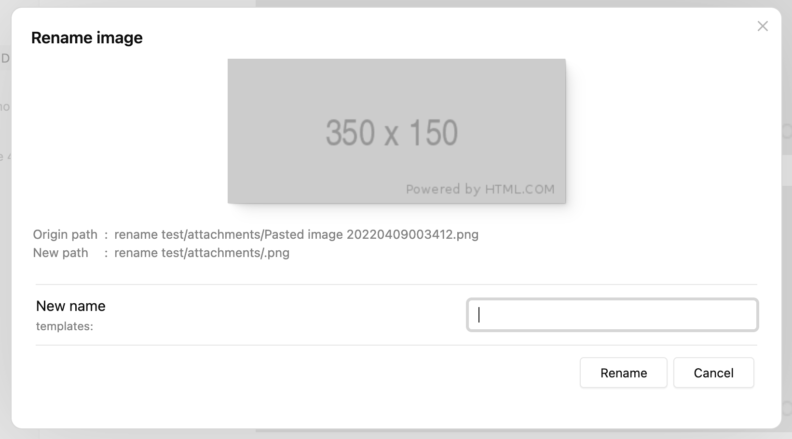
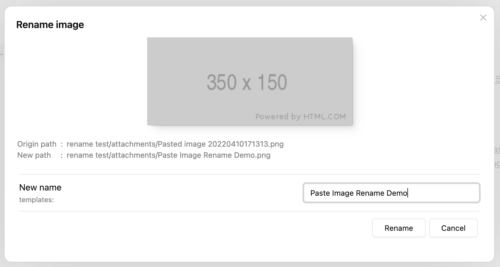
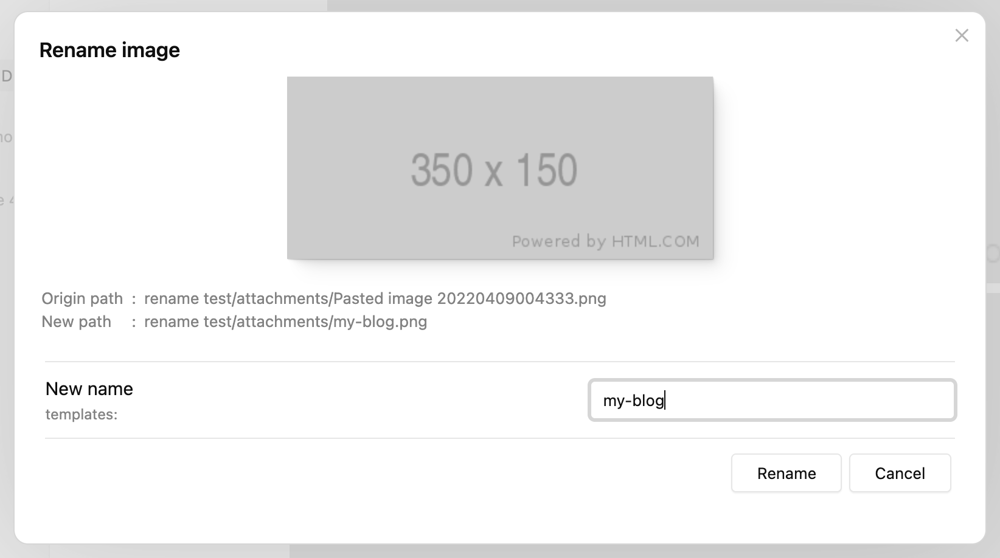
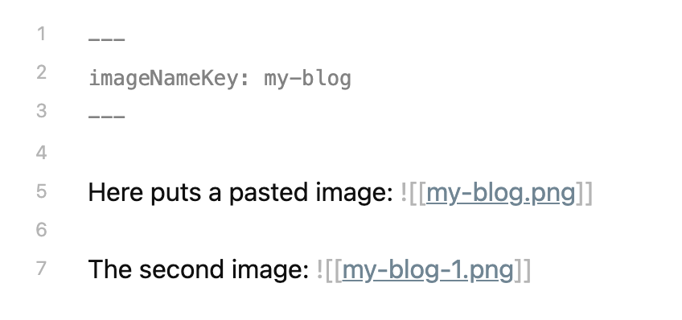
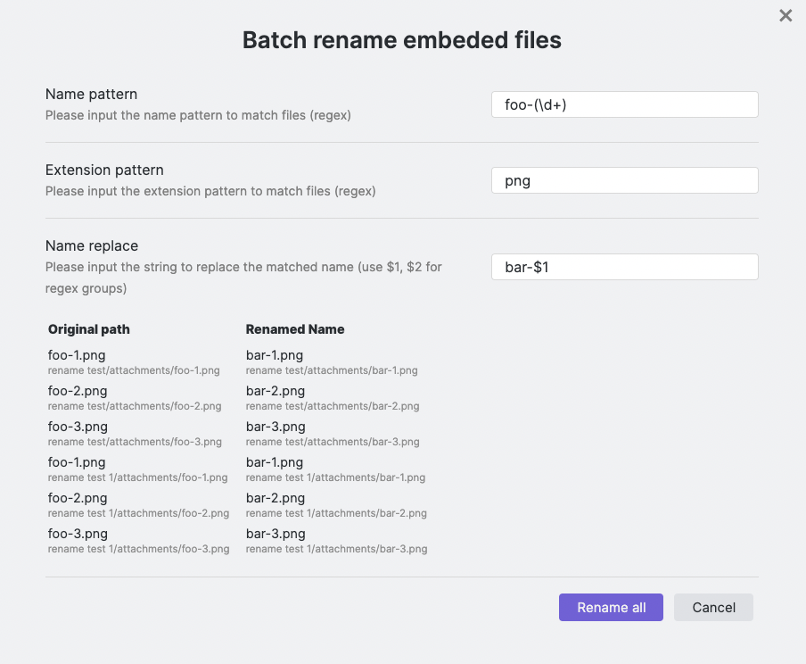
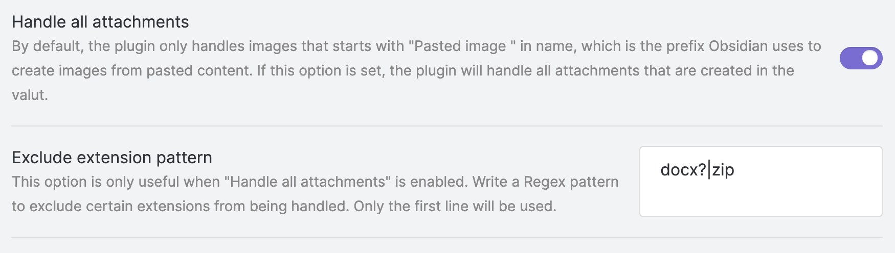

# Obsidian paste image rename

> :loudspeaker: Starting from 1.4.0, Paste image rename becomes a general-purpose renaming plugin
> that can handle all attachments added to the vault.

This plugin is inspired by Zettlr, Zettlr shows a prompt that allows the user to rename the image, this is a great help if you want your images to be named and organized clearly.

<details>
  <summary>Zettlr's prompt after pasting an image</summary>

  
</details>

Paste image rename plugin not only implements Zettlr's feature, but also allows you to customize how the image name would be generated, and eventually free you from the hassle by automatically renaming the image according to the rules.

**Table of Contents**
- [Obsidian paste image rename](#obsidian-paste-image-rename)
  - [How to use](#how-to-use)
    - [Basic usage](#basic-usage)
    - [Set `imageNameKey` frontmatter](#set-imagenamekey-frontmatter)
    - [Add prefix/suffix to duplicated names](#add-prefixsuffix-to-duplicated-names)
    - [Batch renaming process](#batch-renaming-process)
    - [Batch rename all images instantly](#batch-rename-all-images-instantly)
    - [Handle all attachments](#handle-all-attachments)
  - [FAQ](#faq)
  - [Settings](#settings)

## How to use

### Basic usage

After installing the plugin, you can just paste an image to any document and the rename prompt will display:


By typing the new name and clicking "Rename" (or just press enter), the image will be renamed and the internal link will be replaced with the new name.

If you set "Image name pattern" to `{{fileName}}` (it's the default behavior after 1.2.0),
"New name" will be generated as the name of the active file.


### Set `imageNameKey` frontmatter

While adding a lot of images to one document, people possibly want the images to be named in the same format, that's where `imageNameKey` is useful.

First set a value for `imageNameKey` in frontmatter:

```
---
imageNameKey: my-blog
---
```

Then paste an image, you will notice that the "New name" has already been generated as "my-blog", which is exactly the value of `imageNameKey`:


You can change the pattern for new name generating by updating the "Image name pattern" value in settings.

For a detailed explanation and other features such as auto renaming, please refer to [Settings](#settings).


### Add prefix/suffix to duplicated names

The plugin will always try to add a prefix/suffix if there's a file of the same name.

Let's continue from the last section and paste the second image, the prompt will still show the new name as "my-blog", now if we just click "Rename", the file will be renamed as "my-blog-1.png", not "my-blog.png":



The `-1` suffix is generated according to the default settings:
- Because "Duplicate number at start" is false, suffix is used rather than prefix
- "Duplicate number delimiter" `-` is put before the number `1`

If we paste the third image without editing the "New name" input, its name will be "my-blog-2.png", the number is increased according to the largest number of "my-blog-?.png" in the attachment directory.

This feature is especially powerful if you enable "Auto rename" in settings, you can just add new images without thinking, and they will be renamed sequentially by the pattern and `imageNameKey` set.

### Batch renaming process

> New in 1.3.0

You can use the command "Batch rename embeded files in the current file"
to rename images and other attachments (even notes) in the current file.



The image above demonstrates how to rename all the `foo-1.png`, `foo-2.png`… png files
to `bar-1-png`, `bar-2.png`… with this feature.

You can also rename the images to the same name, and let the plugin handle
the name deduplication for you.  See a video demonstration here:
https://i.imgur.com/6UICugX.mp4


### Batch rename all images instantly

> New in 1.5.0

The command "Batch rename all images instantly (in the current file)" will
rename all the images in the current file according to
"Image name pattern" in settings.

This is a shortcut for using [Batch renaming process](#batch-renaming-process) with certain arguments,
makes everyday image renaming much easier.

Note that this command has no confirmation, please use it with caution!

### Handle all attachments

> New in 1.4.0

Paste image rename is not just a plugin for pasted images, it has the potential
to handle all attachments that are added to the vault, no matter whether they are pasted
or dragged.

To use this feature, you need to enable the "Handle all attachments" option in settings.



Additionally, you can configure the "Exclude extension pattern" to ignore files
that match the given extension pattern.


## FAQ

- Q: I pasted an image but the rename prompt did not show up.

    A: This is probably because you are using the Windows system and pasting from a file (i.e. the image is copied from File Explorer, not from a browser or image viewer). In Windows, pasting from a file is like a regular file transfer, the original filename is kept rather than being created and named "Pasted image ..." by Obsidian. You need to turn on "Handle all attachments" in settings to make it work in this situation.

## Settings

- **Image name pattern**

  The pattern indicates how the new name should be generated.

  - Available variables:
    - `{{fileName}}`: name of the active file, without ".md" extension.
    - `{{imageNameKey}}`: this variable is read from the markdown file's frontmatter, from the same key `imageNameKey`.
    - `{{DATE:$FORMAT}}`: use `$FORMAT` to format the current date, `$FORMAT` must be a Moment.js format string, e.g. `{{DATE:YYYY-MM-DD}}`.

  - Examples

    Here are some examples from pattern to image names (repeat in sequence), variables: `fileName = "My note", imageNameKey = "foo"`:
    - `{{fileName}}`: My note, My note-1, My note-2
    - `{{imageNameKey}}`: foo, foo-1, foo-2
    - `{{imageNameKey}}-{{DATE:YYYYMMDD}}`: foo-20220408, foo-20220408-1, foo-20220408-2
- **Duplicate number at start (or end)**

  If enabled, the duplicate number will be added at the start as prefix for the image name, otherwise, it will be added at the end as suffix for the image name.
- **Duplicate number delimiter**

  The delimiter to generate the number prefix/suffix for duplicated names. For example, if the value is `-`, the suffix will be like "-1", "-2", "-3", and the prefix will be like "1-", "2-", "3-".
- **Auto rename**

  By default, the rename modal will always be shown to confirm before renaming, if this option is set, the image will be auto renamed after pasting.
- **Handle all attachments**

  By default, the rename modal will always be shown to confirm before renaming, if this option is set, the image will be auto renamed after pasting.

- **Exclude extension pattern**

  This option is only useful when "Handle all attachments" is enabled.
	Write a Regex pattern to exclude certain extensions from being handled. Only the first line will be used.
- **Disable rename notice**

  Turn off this option if you don't want to see the notice when renaming images.
	Note that Obsidian may display a notice when a link has changed, this option cannot disable that.


## Maintenance and verification

The current backlog, priorities, acceptance criteria, and verified progress are tracked in
[docs/maintenance-plan.md](docs/maintenance-plan.md).

Run `npm ci`, `npm test`, and `npm run build` to execute the isolated regression suite
and produce the plugin bundle in `build/`. Tests mock only the Obsidian runtime boundary;
actual Obsidian testing should use a disposable vault and preserve a baseline copy.

### Safety behavior in the maintenance candidate

- Enable Obsidian's **Automatically update internal links** before renaming so references
  from other notes remain valid. Renaming is blocked if that option is explicitly disabled.
- **Excluded folders** takes one literal vault-relative folder per line. Automatic renaming
  skips attachments or source notes in those folders and descendants; `Telegram` does not
  match `Telegram2`. Manual batch commands remain intentional operations and are unaffected.
- Temporary/hidden files are ignored automatically. An invalid extension exclusion pauses
  automatic renaming until corrected; only its first line is used.
- In batch rename, click **Preview** after changing an input, then **Rename all**.
- **Filename only:** rename operations change an attachment’s name and preserve its directory.
  Directory names, relative paths (including `folder/name` and `../name`), absolute paths,
  Windows drive paths and traversal sequences are unsupported and rejected before renaming.
  This is a permanent scope boundary, not a planned destination-routing feature.
  Configure attachment placement in **Obsidian Settings → Files and links → Default location
  for new attachments**. See the [official attachment-location guide](https://help.obsidian.md/attachments#Change%20default%20attachment%20location). Renaming keeps existing attachments in their current folder. The separate, explicitly selected
  **Cancel and Delete** action moves an eligible new attachment to recoverable vault `.trash`.

### Automatic insertion timing

Automatic handling starts after the workspace finishes loading and waits until the
new attachment is linked or embedded in the Markdown note that was active when it was created.
Old copied timestamps and slow imports are accepted. Files already referenced before
creation (such as sync restores), unrelated unreferenced files, and insertions with no
new parsed reference within 30 seconds are left unchanged. You can still use manual batch
rename afterward. This protects insertion order but cannot identify every external
plugin's intent; use folder exclusions for managed importer/sync folders.

### Pattern examples and compatibility

Patterns describe the filename stem; the original attachment extension is appended.
Do not append `.png` or another extension to the pattern itself.

- `{{fileName}}-{{DATE:YYYY-MM-DD-HHmmss}}` includes both date and time. `DATE`
  already supports Moment time tokens; use one colon after `DATE` and avoid literal
  colons in a filename. All images within one instant batch share a timestamp snapshot.
- `{{frontmatter:permalink}}` reads the `permalink` frontmatter field. Its value must
  be a filename-safe stem rather than a URL or folder path.
- Multiple DATE/frontmatter variables are supported, including numeric zero and false.
- Markdown link destinations may contain `%20` for spaces. This is normal URL encoding;
  changing it to a literal space can make a Markdown link invalid. Renaming preserves
  the chosen link syntax and existing width/alias text where Obsidian provides it.
- Generated and manually entered stems are sanitized for forbidden filename/link
  characters while preserving valid Unicode. Raw batch replacements with forbidden
  characters and reserved Windows device names are rejected before filesystem mutation.

### Original names and slugs

- **Use original name** in the rename prompt copies the attachment's current stem into
  the editable field, sanitizing forbidden characters. It does not submit the rename.
- `{{attachmentName}}` and `{{originalAttachmentFileName}}` mean the attachment stem
  immediately before the current operation, without its extension. For example,
  `{{fileName}}-{{attachmentName}}` can produce `Note-invoice.v1.pdf`. The plugin does
  not maintain a historical-name database: repeating a batch whose pattern prefixes
  `attachmentName` can prefix the current name again.
- `{{fileNameSlug}}` and `{{FileNameSlug}}` trim the note name, lowercase it, and replace
  runs of whitespace with a hyphen. Unicode letters, emoji and punctuation are retained
  before ordinary filename sanitization; there is no ASCII transliteration.
  Optional arguments choose casing and separator: `{{fileNameSlug:lower:underscore}}`
  produces `obsidian_plugin_test_file` from `Obsidian Plugin Test File`;
  `{{fileNameSlug:preserve:underscore}}` produces `Obsidian_Plugin_Test_File`.
  Use `hyphen` instead of `underscore` for the two hyphenated variants.
  Both token aliases accept these arguments. Bare tokens keep their existing
  lowercase-hyphen behavior; unrecognized argument combinations stay literal.

Existing patterns and automatic defaults are unchanged.

`{{fileExt}}` is the current attachment extension without the dot. For example,
`{{fileName}}-{{DATE:YYYYMMDD}}.{{fileExt}}` produces `Note-20261014.png` for a PNG.
A pattern ending in `.{{fileExt}}` explicitly includes the final extension; it is
appended only once, and the rename prompt still edits the stem without the extension.
Used elsewhere, the token is ordinary stem text: `{{fileExt}}-{{fileName}}` produces
`png-Note.png`. Original extension casing is retained. Existing patterns without a
terminal `.{{fileExt}}` keep their previous stem-plus-extension behavior.

`{{DATETIME:format}}` supports Moment date/time formatting, like `{{DATE:format}}`,
plus a small compatibility layer for `%H` (24-hour), `%M` (minute), and `%S` (second).
These directives use two zero-padded digits; `_` space-pads, `-` omits padding, and
`0` explicitly zero-pads (for example `%_H`, `%-M`, `%0S`). `%%` means a literal
percent, and unknown percent-letter directives remain literal. This is not a full
strftime implementation. Moment bracket literals such as `[%H]` and backslash
escapes are preserved. `DATE` behavior is unchanged.

For example, `{{DATETIME:YYYY-MM-DDT%_H:%M:%S}}` renders a date/time using the local
clock. Ordinary filename sanitization still removes forbidden characters such as
colons; prefer `{{DATETIME:YYYY-MM-DD_HH-mm-ss}}` for a portable filename. One batch
uses one clock snapshot for both DATE and DATETIME tokens.

### Optional naming controls

- **Rename input selection** can put the caret at the start, at the end (default), or
  select the full proposed stem. It also applies after **Use original name**.
- **Duplicate number minimum digits** accepts 1–12 (default 1). New numbers can be
  `001`, `002`, and so on, at either end. Existing conforming numbered names remain
  unchanged, even if their padding differs, to avoid repeated-batch churn.
- `{{nearestHeading}}` and `{{headerName}}` use the nearest heading of any level before
  the attachment's earliest parsed link/embed in the captured source note. With no
  preceding heading/reference they are empty. `{{firstHeading}}` remains the first H1.
- `{{UUID}}` creates a version-4 UUID once per file operation. Repeated UUID tokens in
  that pattern share a value; `{{HEX}}` is the same 32 hexadecimal digits without
  hyphens. Another operation generates a fresh value, so rerunning a UUID-pattern
  batch intentionally changes names. Random bytes come from the platform Web Crypto API.

### Sharing duplicate numbers across file types

Enable **Share duplicate numbers across extensions** to use one filename-stem namespace within the existing attachment folder. For example, a mixed batch can become `Note.png`, `Note-1.jpg`, and `Note-2.webp`. The default remains separate numbering per extension. Original extensions and file bytes are unchanged; files are not moved. Existing matching numbers remain stable unless another extension already occupies that same number (leading-zero variants count as the same number). Conflicts are resolved only when a file is processed, and repeated batches are stable. Prefix numbering, delimiters, minimum digits and **Always add duplicate number** still apply.

### Fallback names

Use `{{imageNameKey|dirName|my_default_value}}-{{fileName}}` to select the first nonblank named variable, falling back to the final literal text. This example uses `imageNameKey`, then `dirName`, then `my_default_value`. Whitespace-only values are treated as blank; a selected value is otherwise retained unchanged until ordinary filename sanitization. The final item may itself be a named variable; if all named values are blank, the result is empty. An empty final item is also allowed.

Fallback operands support the plain named variables listed above (including `attachmentName`, `firstHeading`, `UUID` and `HEX`). Unknown intermediate names keep the whole token unchanged, helping reveal typos. Existing `DATE:`, `DATETIME:`, `frontmatter:` and slug-option tokens retain their own syntax, including literal pipes; they are not fallback operands. Inserted values are never interpreted as new template tokens.

Frontmatter `imageNameKey: 0` and `imageNameKey: false` are nonblank values and produce `0` and `false`, just like their quoted forms. Missing/null/empty values fall through. This also corrects bare `{{imageNameKey}}` handling of zero and false.

### Conditional separators around variables

Use `{{dirName:-}}` for a suffix that appears only when `dirName` is nonblank, or `{{__:imageNameKey:__}}` for a literal prefix and suffix. Together, `{{dirName:-}}{{__:imageNameKey:__}}{{fileName}}` produces `Folder-__key__Note`, `Folder-Note`, `__key__Note`, or `Note`, depending on which variables are present. Whitespace-only values omit the entire conditional token. Zero and false are retained. `{{prefix:variable:}}` gives a prefix only.

This opt-in syntax supports plain named variables; affixes cannot contain a colon or pipe, and cannot wrap a fallback chain or formatted token. Existing DATE/DATETIME/frontmatter and slug-option syntax keeps precedence, including invalid slug-option tokens. For a conditional slug suffix, use the three-part form `{{:fileNameSlug:-}}`. Prefixes/suffixes and inserted values are literal data, subject to ordinary filename safety. Existing patterns keep their literal dashes; there is no global trimming or executable template language.

### Convert Markdown image links to wiki embeds

The conversion command requires the editor transaction API (Obsidian 0.13.0 or newer) and checks its availability before opening a preview. Run **Convert Markdown image links to wiki embeds (current note)** from the command palette. Review the proposed changes and skipped-reference reasons, then choose **Convert supported images**. This is an independent command: it changes only the open Markdown note in one undoable editor transaction. It never renames, moves or deletes image files, and does not run automatically on insertion. If the note, active editor or target files change after preview, cancel and run the command again.

Supported forms are local inline images with an empty label or numeric dimensions, such as ``, `` and ``. They become wiki embeds with the same resolved image and dimensions. Canonical vault-relative paths avoid changing which image is referenced. Nonempty descriptive alt text, titles, reference-style images, remote URLs, fragments, ambiguous escaping/entities and unsafe wiki filenames are skipped rather than losing semantics. Code, frontmatter, comments, math, HTML-containing paragraphs, tables and linked-image labels are protected. The command conservatively leaves the remaining note unchanged after the first Obsidian math/comment opener outside parsed literal/link content, or an HTML opening tag; it does not guess where these Obsidian-specific regions end. The preview reports these protected skips.

Preview limits are 2 million note characters, 1000 image references and 10000 protected regions. The CommonMark/GFM parser is bundled; its MIT notices are included in the distributed `main.js` and `THIRD_PARTY_LICENSES.txt`. Normal editor Undo reverses the conversion; no file operation needs undoing.

### Drawing sources are excluded

Canvas and Excalidraw drawing sources are excluded from attachment tracking, rename prompts, both batch commands and Markdown-image conversion, including Excalidraw drawings opened in Markdown mode. Legacy `.excalidraw`, `.excalidraw.md` and `.canvas` names, or a truthy `excalidraw-plugin` frontmatter marker, identify these sources. Newly edited frontmatter is checked in all open Markdown editors too. Once a source is identified as a drawing, it remains excluded until the plugin reloads, even if its marker is removed or metadata is temporarily missing. Unavailable source metadata or malformed/unclosed frontmatter makes commands stop safely; wait for indexing or correct the frontmatter and try again.

This is protective exclusion, not full Canvas/Excalidraw integration. Their ordinary PNG/JPG/etc. assets cannot be identified by image extension alone. References from an ordinary Markdown note may still point to drawing-owned assets; the plugin cannot prove ownership across every integration.

### Cancel and Delete (conservative new-paste discard)

A manual rename prompt can offer **Cancel and Delete** for a verified new, single-file native paste/drop. It removes only that insertion's link, saves and verifies the note, then moves the byte-verified image to the vault's recoverable `.trash` folder. Ordinary Cancel, Escape and dismissal never delete anything. Once Rename starts, discard is disabled; discard itself can be attempted only once per prompt. Editor Undo restores text only, **not the trashed image**; restore the image separately from `.trash` if needed.

This optional capability requires Obsidian1.1.1+ and the public editor save/transaction APIs. Turn off `Auto rename` to use this action. Eligibility expires30seconds after the trusted gesture and requires no selected text, exactly one newly created attachment, an exact new parsed reference, and identical clipboard/file bytes. Reused files, multiple-file gestures, edited or moved sources/files, closed prompts and unverified clipboard cases cannot be discarded. Files larger than20MB are rejected before clipboard reading. A paste that also creates a new attachment folder is conservatively ineligible; create the folder first or use the vault root.

The first version intentionally supports verifiable Markdown + raster-image vaults only. Canvas, Excalidraw, SVG and every other unsupported file/container refuse deletion with a reason. Dirty competing editors, shared references or even ambiguous filename mentions, unresolved indexing, HTML/code/plugin/math/comment syntax, HTML entities, unsupported URI/query references, malformed frontmatter and oversized scans also refuse. Limits are2000files/folders,200MB total scanned content and2million characters per note; Markdown files over4MB are rejected. Physical file inventory and current disk/editor text are checked rather than relying on stale resolved-link counts. Standard `.obsidian`, `.trash` and `.git` internals are outside this vault-content check; arbitrary third-party private state or external applications are not ownership-certified.

A failed save or verification keeps the attachment. If safe, the exact removed link is restored; concurrent changes prevent compensation and produce an explicit partial-result warning. An uncertain trash result is never retried automatically. No permanent-delete fallback is used.
